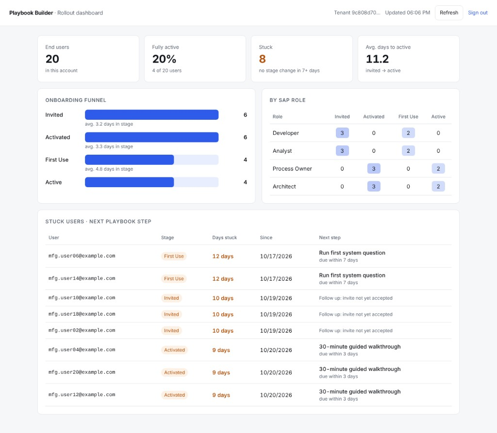
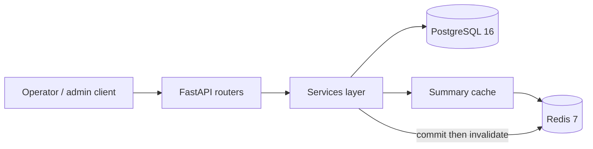

# Onboarding Playbook Tracker

Multi-tenant customer onboarding API and dashboard: create accounts, invite users, move them through stages with a reusable playbook, and see who is stuck.

Stack: FastAPI · PostgreSQL · Redis · Docker.

**[Live demo →](https://conduct-playbook-api.onrender.com/dashboard)** Click **View demo data** for an instant look. The free host sleeps when idle, so the first load can take up to a minute.

## Why it exists

After a B2B sale, a small customer-success team often onboards many end users per account. Invites and stage tracking usually live in spreadsheets, so capacity grows mainly by hiring.

This tool turns that into reusable playbooks and a clear view of rollout progress per account.

## Features

- **Tenants & invites** — create a customer account, invite end users, accept invites (argon2 passwords), advance stages one step at a time (`invited → activated → first_use → active`)
- **Playbooks** — global default template copied per tenant; next steps for a user’s current stage
- **Rollout summary** — users per stage, role × stage counts, stuck count, average days per stage (SQL aggregates)
- **Stuck users** — paginated list with days stuck and the next playbook step
- **Redis cache** for summaries, invalidated **after** DB commit; Postgres fallback if Redis is down
- **Security** — HS256 JWTs, tenant scoping, invite token hashing, no personal data in logs
- **Seed data** — fictional demo tenants via `make seed` (idempotent)
- **Rollout dashboard** — browser UI at `/dashboard`



## Architecture



Layers: **routers** = HTTP only; **services** = business rules; **models** = persistence.

## Security model

| Concern | Behaviour |
| --- | --- |
| Roles | `strategist` (platform), `customer_admin` (one tenant), `end_user` (no management APIs) |
| Tenant isolation | Every tenant-scoped query goes through `accessible_tenant_ids`; inaccessible tenants return **404**, not 403 |
| Invites | `secrets.token_urlsafe(32)`; store **SHA-256 hash only**; expiry + single use |
| Passwords | argon2 |
| Auth | Short-lived HS256 JWTs with validated `exp` |
| Logs | IDs only — never emails, names, passwords, tokens, or JWTs |

Design write-ups: [`docs/decisions.md`](docs/decisions.md). Portfolio one-pager: [`PORTFOLIO.md`](PORTFOLIO.md).

## Live demo (Render free)

Blueprint: [`render.yaml`](render.yaml).

- Dashboard: <https://conduct-playbook-api.onrender.com/dashboard>
- API docs: <https://conduct-playbook-api.onrender.com/docs>
- Health: <https://conduct-playbook-api.onrender.com/health>

Free web services **cold-start** after idle (~30–60s). Free Postgres is temporary — fine for a portfolio demo.

## Prerequisites

- Docker Desktop (or compatible engine) with Compose
- [uv](https://docs.astral.sh/uv/) and Python 3.12
- Ports free: `8000`, `5432`, `5435`, `6379`

## Quick start

```bash
cp .env.example .env   # set JWT_SECRET (32+ chars)
make up
make migrate
make seed
```

API: <http://localhost:8000/docs> · Dashboard: <http://localhost:8000/dashboard>

### Seed logins

| Role | Email | Password |
| --- | --- | --- |
| Strategist | `strategist@example.com` | `seed-strategist-pass-1` |
| Admin (Example Manufacturing GmbH) | `admin@example-manufacturing.example` | `seed-admin-pass-1` |
| Admin (Demo Logistics AG) | `admin@demo-logistics.example` | `seed-admin-pass-1` |

Each fictional account seeds about 100 end users (developers, analysts, process owners, architects) plus five named colleagues. Anyone not still in `invited` can sign in with `seed-user-pass-1`.

| Account | Named colleagues (demos) |
| --- | --- |
| Example Manufacturing GmbH | Dana Vogel, Jonas Keller, Mira Hoffmann, Lukas Berger, Anja Schmitt |
| Demo Logistics AG | Peter Lang, Sofia Meier, Henrik Wolf, Clara Neumann, Tobias Klein |

Emails are the lowercase name plus `@example.com` (for example `dana.vogel@example.com`).

## Make targets

| Target | What it does |
| --- | --- |
| `make up` | Compose up (Postgres, Redis, test DB, API) |
| `make down` | Compose down |
| `make migrate` | Alembic upgrade |
| `make seed` | Idempotent fictional demo data |
| `make lint` | ruff check + format check |
| `make typecheck` | mypy `--strict` |
| `make test` | pytest |
